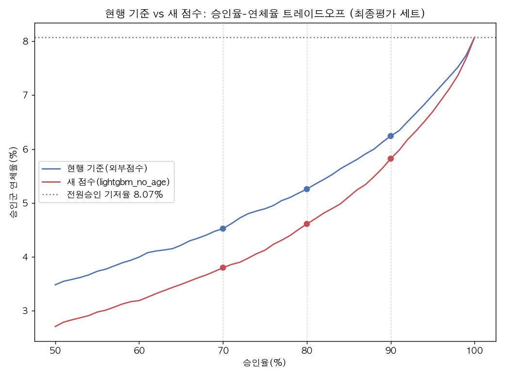
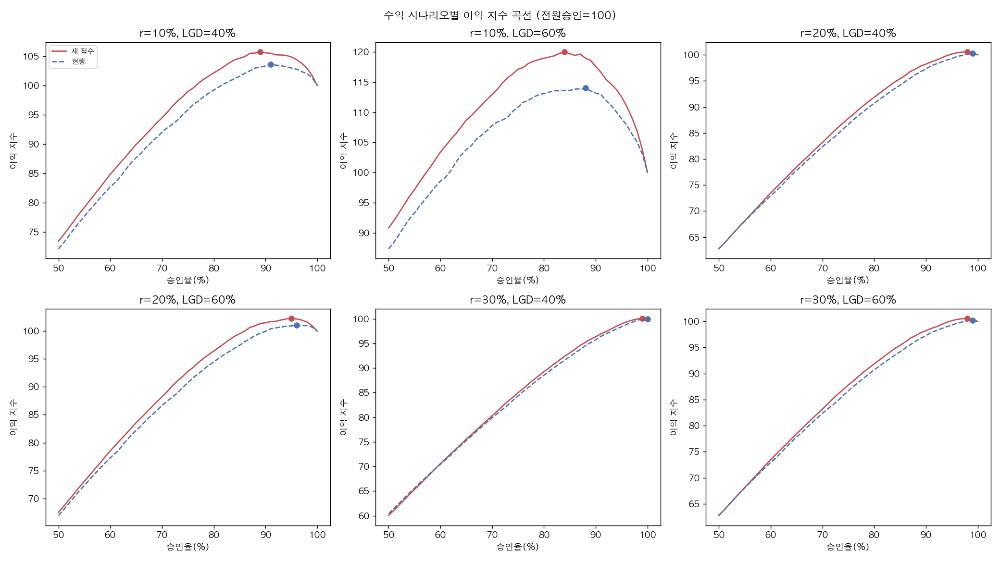
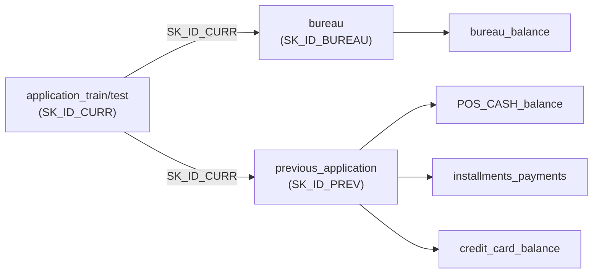

# 연체 위험 기반 대출 승인 기준 설계
Loan Approval Risk Scoring

> 승인율 80%로 심사하면 승인 고객 연체율이 8.1%에서 4.6%로 떨어진다. 외부 신용점수만 쓸 때(5.3%)보다 12% 더 낮은 수준으로, 신청 1만 건당 연체 고객이 약 52명 줄어든다. 같은 연체율을 유지한다면 승인을 6%p(1만 건당 600건) 더 늘릴 수 있다.



## 한눈에 보기

| 항목 | 내용 |
|---|---|
| 문제 | 대출 신청자의 상환 이력 데이터로 연체 위험을 점수화하고, 승인 기준으로 쓸 수 있는 근거를 설계 |
| 데이터 | Kaggle Home Credit Default Risk(2018), 8개 테이블, 신청자 307,511명 |
| 역할·기간 | 팀(3명) 모델링(2026.08) + 개인 재설계(2026.10) |
| 기술 | Python, DuckDB, scikit-learn, LightGBM, SHAP |

## 목차

1. [문제 정의](#1-문제-정의)
2. [결과](#2-결과)
3. [한계와 다음 단계](#3-한계와-다음-단계)
4. [판단 기록](#4-판단-기록)
5. [데이터](#5-데이터)
6. [분석 과정](#6-분석-과정)
7. [SQL 하이라이트](#7-sql-하이라이트)
8. [AI 활용 방식](#8-ai-활용-방식)
9. [재현 방법](#9-재현-방법)
10. [저장소 구조](#10-저장소-구조)
11. [역할](#11-역할)
12. [이전 버전(v1)](#12-이전-버전v1)
13. [데이터 이용 조건과 라이선스](#데이터-이용-조건과-라이선스)

## 1. 문제 정의

| 구분 | 내용 |
|---|---|
| 현상 | 신청 건수가 늘어날수록 수기 심사만으로는 감당하기 어렵고, 심사자마다 기준이 달라질 위험이 있다 |
| 문제 | 외부 신용점수만으로는 승인 여부를 가르는 근거가 충분하지 않다 |
| 목표 | 신청자의 상환 이력 데이터로 연체 위험을 점수화해, 외부 신용점수 대비 더 나은 승인 기준을 만든다 |

국내에서도 카드대출 연체율이 상승하는 추세이며, 이는 대출 심사 기준을 데이터로 재설계할 필요성을 보여주는 배경이다([참고 기사](https://www.tfmedia.co.kr/news/article.html?no=196669)).

## 2. 결과

**같은 승인율에서 새 점수가 연체율을 더 낮춘다.**

| 승인율 | 현행 기준 연체율 | 새 점수 연체율 | 차이 | 95% 신뢰구간 |
|---|---|---|---|---|
| 70% | 4.522% | 3.798% | 0.725%p | [0.592, 0.871] |
| 80% | 5.256% | 4.610% | 0.646%p | [0.524, 0.768] |
| 90% | 6.242% | 5.821% | 0.421%p | [0.327, 0.529] |

세 승인율 모두 95% 신뢰구간(참값이 있을 것으로 추정되는 범위) 하한이 0보다 크다. 같은 연체율 기준으로 보면 현행 기준의 승인율 80% 지점 연체율(5.256%)을 새 점수는 승인율 86%에서도 달성한다(95% CI [5, 7]%p 증가).

**스왑셋**(두 기준의 승인 여부가 엇갈리는 집단, 승인율 80% 기준)을 보면 두 모델의 차이가 더 분명해진다. 현행은 승인했지만 새 점수가 거절한 집단(swap-out)의 연체율은 16.93%로, 현행은 거절했지만 새 점수가 승인한 집단(swap-in)의 8.64%보다 두 배 가까이 높다. 새 점수가 현행 기준이 놓친 고위험군을 더 정확히 짚어낸다는 뜻이다.

**수익 가정을 바꿔도 결론은 비슷하다.** 이자수익률 10~30%, 손실률 40~60%를 조합한 6개 시나리오(가정값) 모두에서 새 점수의 이익 최대 지점이 승인율 50~100% 범위 안쪽에 있었다. 이 모델이 돈이 되는 곳은 마진이 낮고 손실이 큰 상품이다. 이자수익률 10%·손실률 60% 조합에서 이익 지수가 현행 대비 +6.0(114.0→120.0) 올랐지만, 이자수익률 20~30% 조합에서는 최적 승인율이 95~99%로 이미 높아 개선폭이 +0.04~1.2에 그쳤다.



상세 수치와 판정 기준은 [v2/docs/07_final_evaluation.md](v2/docs/07_final_evaluation.md) 참고.

## 3. 한계와 다음 단계

- **승인된 고객만 있는 데이터다.** 과거에 거절된 신청자의 실제 상환 여부는 알 수 없어, 이 데이터로 학습한 모델은 "승인했다면 어땠을까"를 거절자에게 그대로 적용하기 어렵다.
- **현행 기준은 대용(proxy)이다.** 실제 회사의 기존 심사 점수가 아니라 외부 신용점수만 쓰는 심사를 가정해 만든 비교 기준이다.
- **날짜 정보가 없다.** 신청일 기준 상대 일수만 있어 시간순 분할을 할 수 없었고, 학습/검증/평가 세트는 무작위 층화추출로 나눴다.
- **수익 가정은 가정값이다.** 이자수익률과 손실률은 실제 재무 데이터가 아니라 6개 시나리오로 가정한 값이다.

다음 단계로는 기존 심사와 새 점수를 동시에 운영하며 결과를 비교하는 챔피언-챌린저 병행 검증, 거절 대상 중 일부를 실험적으로 승인해 실제 상환 데이터를 확보하는 작업을 검토할 수 있다.

## 4. 판단 기록

**1) 1단계 보고서의 고아 비율 분모 오류 수정**
상황: "credit_card_balance의 94.4%가 고아"라고 적혀 있었다.
선택: 양방향으로 다시 계산해 분모를 분리했다.
이유: 94.4%는 previous_application 쪽 비율이었고, credit_card_balance 자체의 고아 비율은 28.2%였다.
결과: 하위 테이블 집계 시 진짜 고아만 제외하고 자체 SK_ID_CURR로 직접 연결하는 원칙을 세웠다.

**2) H2(상환부담) 기각 원인 추적**
상황: 소득 대비 상환액 비율(IV 0.0060)이 예상과 달리 거의 변별력이 없었다.
선택: "기존 심사가 이미 부담이 큰 신청자를 걸러냈다"는 가설을 정황 증거로만 탐색했다.
이유: 단정할 근거(심사 로그 등)가 없어 결과를 과장하지 않으려 했다.
결과: 외부 신용점수를 통제하면 관련 변수의 역방향 신호가 약해진다는 점만 확인했다.

**3) 설명 가능성과 성능의 교환**
상황: application 컬럼 전체(133개)를 쓰면 검증 AUC가 0.7747까지 오른다.
선택: 가설 변수 중심의 23개 변수로 구성된 모델을 최종으로 썼다.
이유: 변수 하나하나의 의미를 설명할 수 있어야 승인 기준으로 쓸 수 있다.
결과: 포기한 성능은 AUC 기준 약 0.007이었다.

**4) 민감 정보 제외**
상황: 성별, 주변인 연체 관측, 나이가 모두 모델 성능에 기여할 수 있었다.
선택: 성별과 주변인 연체 관측 4개는 처음부터 완전히 뺐고, 나이는 미리 정한 기준(제외 시 AUC 하락 0.005 미만)으로 뺐다.
이유: 차별 소지가 있는 정보를 심사 기준에 넣지 않기 위해서다.
결과: 나이를 빼도 AUC는 0.7699에서 0.7680으로 0.0020만 떨어져 손해가 거의 없었다.

**5) 결과를 보기 전에 기준을 먼저 고정**
상황: 가설 판정, 모델 선택, 승인 개선 판정 기준을 미리 정하지 않으면 결과에 맞춰 기준을 바꿀 위험이 있다.
선택: IV 0.02, 모델 선택 AUC 차이 0.01, 나이 판정 AUC 하락 0.005, H6/H7 판정 기준을 작업 시작 전에 코드 상수로 고정했다.
이유: 기준이 결과를 따라가면 어떤 결론도 사후에 정당화할 수 있어 버린다.
결과: H2처럼 기각된 가설도 그대로 보고했다.

**6) 외부 점수 몫과 모델 몫 분리**
상황: 외부 신용점수(EXT_SOURCE)만으로도 AUC 0.72가 나와, 새 모델의 개선분이 외부 점수 덕분인지 다른 변수 덕분인지 불분명했다.
선택: 외부 점수만 쓰는 로지스틱 회귀를 "현행 기준(Champion)"으로 따로 만들어 비교 기준으로 삼았다.
이유: 새 점수가 외부 점수 위에 실제로 무엇을 더했는지 분리해서 봐야 한다.
결과: 검증 세트 기준 외부 점수 단독 AUC 0.7225 대비 새 점수 AUC 0.7680로, 상환 행동·거절 이력 등 추가 변수가 AUC 기준 약 0.046을 더했다.

## 5. 데이터

Kaggle "Home Credit Default Risk"(2018)는 `SK_ID_CURR`(신청자 단위 키) 중심으로 연결된 8개 테이블로 구성된다.



신청자 307,511명 기준 기저 연체율은 8.07%다. 이력 보유 현황은 과거 자사 신청 이력 94.6%, 타 금융기관 이력 85.7%였고, 둘 다 전혀 없는 신청자는 0.8%뿐이었다. 신규 고객보다 재이용 고객이 압도적으로 많은 모집단이다.

**처리한 데이터 품질 문제**:
- **고아 레코드**: 하위 테이블의 키가 상위 테이블에 없는 행(예: credit_card_balance의 28.2%)을 제외하고, 각 테이블이 자체 보유한 SK_ID_CURR로 직접 연결했다.
- **365243 특수값**: 재직일수(DAYS_EMPLOYED)의 18%가 비현실적인 365243이었다. 결측으로 바꾸고 별도 플래그를 만들었다.
- **누수 컬럼 제외**: 신청 시점 이후에만 알 수 있는 컬럼(과거 신청의 실제 종료일 등)은 변수 생성에 쓰지 않았다.
- **날짜 부재**: 절대 날짜 컬럼이 없어 시간순 검증을 할 수 없었다. 무작위 층화추출로 학습 184,506명, 검증 61,502명, 최종평가 61,503명으로 나눴다.

전체 테이블 구조와 결측률은 [v2/docs/01_data_audit.md](v2/docs/01_data_audit.md), 122개 컬럼의 업무 의미별 분류는 [v2/docs/02_variable_catalog.md](v2/docs/02_variable_catalog.md) 참고.

## 6. 분석 과정


5개 가설을 세우고 학습 세트(60%)에서만 검증했다. 핵심 지표는 **IV**(Information Value, 변수가 정상/연체를 얼마나 잘 가르는지 나타내는 값으로 0.02 이상이면 변별력이 있다고 본다)다.

| 가설 | 핵심 변수 | IV | 위험군이 안전군보다 연체할 배수 | 판정 |
|---|---|---|---|---|
| H1 상환행동 | 분할상환 지연 비율 | 0.0645 | 1.88배 | 채택 |
| H2 상환부담 | 소득 대비 상환액 비율 | 0.0060 | - | 기각 |
| H3 자금압박 | 과거 거절 비율 | 0.0677 | 1.96배 | 채택 |
| H4 생활안정성 | 재직 기간 | 0.1130 | 2.53배 | 채택 |
| H5 대출조건 | 대출금÷물건가격 | 0.0680 | 1.86배 | 채택 |

채택된 가설의 변수와 외부 신용점수를 합쳐 모델 후보 세 가지를 만들고, 검증 세트(20%)로 비교했다.

| 모델 | 변수 수 | 검증 AUC | KS | Gini |
|---|---|---|---|---|
| 현행 기준(외부 신용점수만) | 6 | 0.7225 | 0.3309 | 0.4450 |
| 스코어카드(로지스틱 회귀) | 24 | 0.7533 | 0.3811 | 0.5066 |
| LightGBM(나이 포함) | 24 | 0.7699 | 0.4067 | 0.5398 |
| **최종: LightGBM(나이 제외)** | **23** | **0.7680** | 0.4074 | 0.5359 |
| 참고용(application 전체 컬럼) | 133 | 0.7747 | 0.4115 | 0.5494 |

모델 선택 기준은 작업 전에 고정했다: LightGBM과 스코어카드의 AUC 차이가 0.01 이상이면 LightGBM을 선택하고(0.0166으로 충족), 선택된 모델에서 나이를 뺐을 때 AUC 하락이 0.005 미만이면 나이를 뺀 버전을 최종으로 쓴다(0.0020으로 충족). 가설 검증 전 과정은 [v2/docs/04_signal_hypotheses.md](v2/docs/04_signal_hypotheses.md), 모델링 전 과정은 [v2/docs/06_modeling.md](v2/docs/06_modeling.md) 참고.

## 7. SQL 하이라이트

[v2/scripts/04_build_hypothesis_features.py](v2/scripts/04_build_hypothesis_features.py)에서 발췌한 쿼리 두 개다.

**카드 최신 월 이용률**. 신청자가 카드를 여러 장 가진 경우, 카드별로 가장 최근 월의 잔액/한도만 남겨야 "현재 이용률"의 의미가 성립한다.

```sql
cc_latest AS (
    SELECT SK_ID_CURR, SK_ID_PREV, AMT_BALANCE, AMT_CREDIT_LIMIT_ACTUAL,
           ROW_NUMBER() OVER (PARTITION BY SK_ID_PREV ORDER BY MONTHS_BALANCE DESC) AS rn
    FROM cc_filtered
),
cc_util_agg AS (
    SELECT SK_ID_CURR,
           SUM(AMT_BALANCE) * 1.0 / NULLIF(SUM(AMT_CREDIT_LIMIT_ACTUAL), 0) AS card_utilization
    FROM cc_latest
    WHERE rn = 1
    GROUP BY SK_ID_CURR
)
```

카드(SK_ID_PREV)별로 `ROW_NUMBER() OVER (PARTITION BY ...)`로 최신 순위를 매긴 뒤 `rn=1`만 남기고, 잔액 합÷한도 합으로 가중 이용률을 계산한다.

**bureau_balance 진짜 고아 제외 후 신청자 연결**. bureau_balance는 신청자 키(SK_ID_CURR)가 없어, bureau를 거쳐야 신청자에 연결할 수 있다.

```sql
bureau_balance_joined AS (
    SELECT b.SK_ID_CURR, bb.STATUS
    FROM read_csv_auto(bureau_balance) bb
    INNER JOIN read_csv_auto(bureau) b ON bb.SK_ID_BUREAU = b.SK_ID_BUREAU
),
bureau_balance_agg AS (
    SELECT SK_ID_CURR, COUNT(*) AS n_bureau_balance_records,
           AVG(CASE WHEN STATUS IN ('1','2','3','4','5') THEN 1.0 ELSE 0.0 END) AS bureau_balance_delinquent_month_ratio
    FROM bureau_balance_joined
    GROUP BY SK_ID_CURR
)
```

INNER JOIN 자체가 "bureau에 없는 진짜 고아"를 자동으로 제외하는 필터 역할을 하고, 이후 신청자 단위로 월별 연체 상태 비율을 집계한다.

## 8. AI 활용 방식

**내가 정한 것**: 문제 정의, 5개 가설, 가설·모델 판정 기준, 제외 변수 원칙, 결론 표현.

**AI(Claude Code)가 한 것**: 변수 생성·모델링 코드 작성과 실행, 문서 초안 작성.

**검토하고 바로잡은 것**: AI가 작성한 1단계 보고서에서 고아 비율 분모 해석 오류를 발견했다("credit_card_balance의 94.4%가 고아" → 실제로는 previous_application의 94.4%가 카드 기록이 없는 것이고, credit_card_balance 자체의 고아 비율은 28.2%였다). 실행 중에는 DuckDB 중복행 오집계, 저카디널리티 변수 구간화 오류, 모델 파일명 불일치, 분위수 계산의 부동소수점 오류까지 총 4건의 버그를 발견해 수정했다. 자세한 내용은 [v2/docs/code_guide.md](v2/docs/code_guide.md)의 "실행 중 발견·수정한 버그" 절에 스크립트별로 정리했다.

검증 체크리스트([v2/verification/](v2/verification/))를 직접 계산용으로 만들어 뒀지만, 이 저장소를 정리하는 시점까지 기록([verify_log.md](v2/verification/verify_log.md))은 비어 있다. 아직 체크리스트 전체를 손으로 재계산해 대조하지는 않았다.

## 9. 재현 방법

환경: Python 3.13

```bash
pip install -r requirements.txt

# 1) 데이터 준비: Kaggle "Home Credit Default Risk"에서 8개 CSV를 내려받아
#    data/raw/에 배치한다(data/는 .gitignore 처리되어 저장소에 포함되지 않음)

# 2) 순서대로 실행
python3 v2/scripts/01_data_audit.py
python3 v2/scripts/02_variable_catalog.py
python3 v2/scripts/03_split.py
python3 v2/scripts/04_build_hypothesis_features.py
python3 v2/scripts/05_test_signal_hypotheses.py
python3 v2/scripts/06_h2_followup.py
python3 v2/scripts/07_models.py
python3 v2/scripts/08_final_evaluation.py
```

## 10. 저장소 구조

```
.
├── v2/                   # 현재 버전: 원데이터 점검부터 최종 평가까지
│   ├── scripts/          # 01~08 분석 스크립트
│   ├── docs/             # 단계별 보고서, 그림
│   └── verification/     # 검증 체크리스트, 노트북
├── archive/
│   ├── v1/               # 이전 버전(팀 모델링 + 개인 서빙·배포·모니터링)
│   └── amex/             # 더 이전의 AMEX 데이터 버전
├── docs/internal/        # 내부 작업 문서
├── requirements.txt
└── LICENSE
```

## 11. 역할

부트캠프 팀 프로젝트(3명)로 시작했다. 3명이 각자 8개 테이블 결합부터 모델링까지 진행해 가장 좋은 모델을 채택했고, 본인은 기획서와 보고서를 담당했다. 이후 서빙·배포·모니터링은 개인적으로 확장했다([12. 이전 버전](#12-이전-버전v1) 참고). 이번 v2는 문제 정의부터 최종 평가까지 개인적으로 재설계했다.

## 12. 이전 버전(v1)

부트캠프 팀 모델링에 개인적으로 FastAPI 서빙, Docker 배포, AWS EC2, PSI 드리프트 모니터링을 더한 버전이다. 결과를 이미 알고 거꾸로 분석 스토리를 구성한 부분이 있어 v2에서는 가설을 먼저 세우고 결과를 검증하는 순서로 바꿨다. 자세한 내용은 [archive/v1/README.md](archive/v1/README.md) 참고.

## 데이터 이용 조건과 라이선스

코드는 MIT 라이선스를 따른다([LICENSE](LICENSE)). 데이터는 Kaggle "Home Credit Default Risk" 원 출처의 이용 조건을 따르며, 이 저장소에는 포함하지 않는다.
