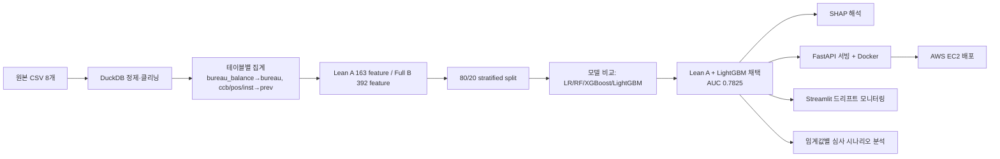
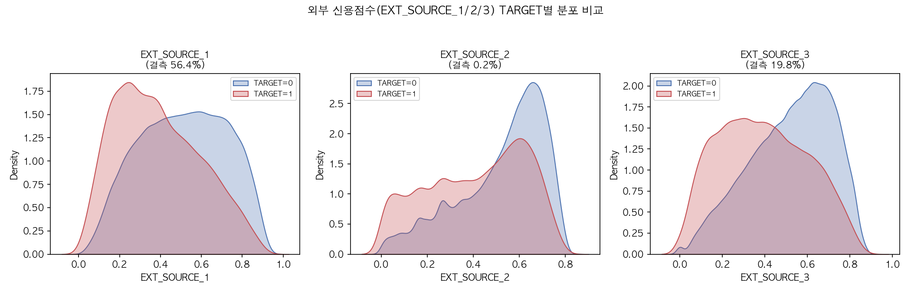
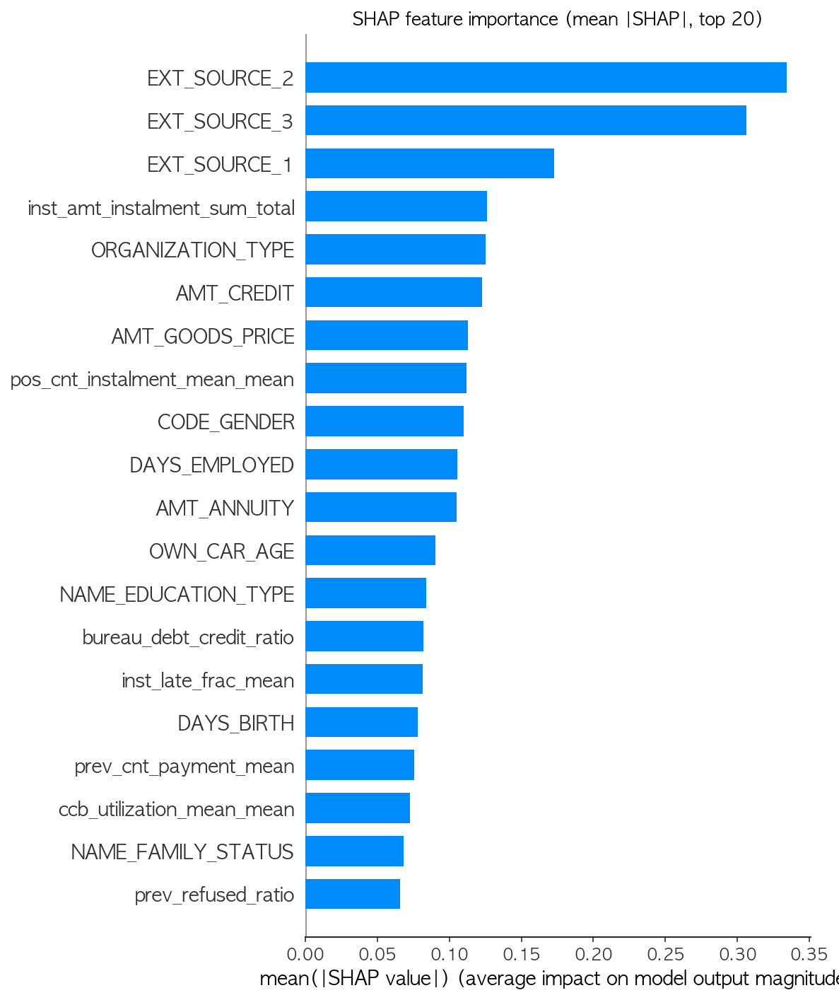
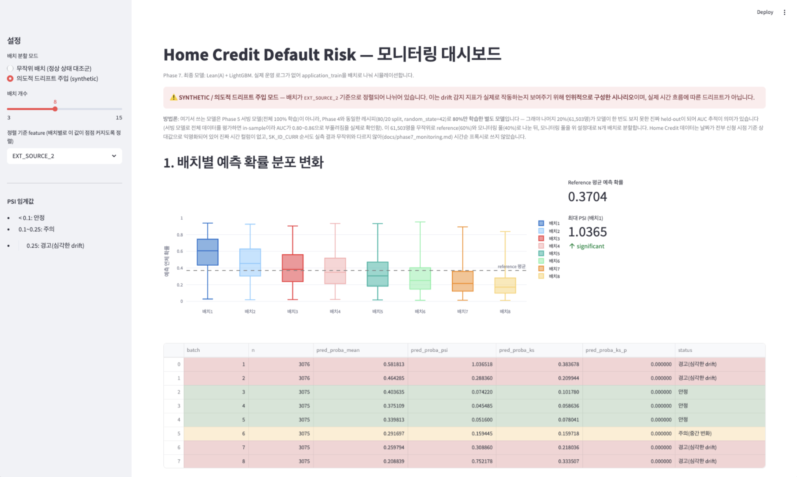

# 대출 채무불이행 예측
Home Credit Default Risk

한 줄 요약: 8개 신용이력 테이블로 대출 신청자의 연체 가능성을 예측하고, 심사 임계값별 승인율-연체율 트레이드오프까지 제시하는 분석이다.

[](https://github.com/dan980918-coder/home-credit-default-risk/actions/workflows/ci.yml)


## 한눈에 보기

| 항목 | 내용 |
|---|---|
| 문제 | 대출 신청자의 상환 이력 데이터로 연체 가능성을 예측하고, 심사에 쓸 임계값 기준을 설계 |
| 데이터 | Kaggle Home Credit Default Risk(2018), 8개 테이블, 신청자 307,511명 |
| 역할·기간 | 팀(3명) 모델링(2026.08) + 개인 확장(서빙·배포·모니터링·임계값 분석, 2026.08~09) |
| 기술 | Python, DuckDB, LightGBM, SHAP, FastAPI, Docker, AWS EC2, Streamlit |

**핵심 결과**
- Lean(A) + LightGBM이 12개 모델·데이터셋 조합 중 최고 성능(검증 AUC **0.7825**, App-only 대비 **+0.0202**, 5-fold CV 기준)을 기록해 최종 채택됐다.
- 임계값을 0.60으로 두면 승인율 81.4%를 유지하면서 승인군 연체율을 기저치 8.1%의 절반 수준인 4.6%까지 낮출 수 있다(Recall 53.8%).
- Docker 이미지 238MB, 정상 상태 PSI(모집단 안정성 지표) 0.00~0.02, 드리프트 주입 시 6.2~7.1까지 치솟아 경고 12건을 오탐·미탐 없이 탐지했다.

**제안**: 별도 기준이 없다면 임계값 0.60을 심사 기본값으로 채택해 승인율 81%대를 유지하면서 연체율을 거의 절반으로 낮출 것을 제안한다.

## 목차

1. [문제 정의](#1-문제-정의)
2. [데이터](#2-데이터)
3. [분석 설계](#3-분석-설계)
4. [핵심 결과](#4-핵심-결과)
5. [제안](#5-제안)
6. [판단 기록](#6-판단-기록)
7. [한계와 다음 단계](#7-한계와-다음-단계)
8. [재현 방법](#8-재현-방법)
9. [저장소 구조](#9-저장소-구조)
10. [역할](#10-역할)

## 1. 문제 정의

대출 신청자 중 상환 능력이 부족한 사람을 사전에 가려내는 일은 금융기관의 핵심 리스크 관리 과제다. 신청 건수가 많아지면 수기 심사만으로는 감당하기 어렵고, 심사자마다 기준이 달라질 위험도 있다. 이 프로젝트는 신청자의 신용 이력 데이터로 연체 가능성을 점수화하는 모델을 만들고, 그 점수를 실제 심사에 쓸 수 있는 임계값 기준으로 바꾸는 것을 목표로 한다. 신용평가 모델 담당자나 리스크 심사 정책 담당자가 참고할 수 있는 분석이다.

## 2. 데이터

Kaggle "Home Credit Default Risk"(2018)는 단일 파일이 아니라 8개 CSV가 `SK_ID_CURR`(고객·신청 단위 키) 중심으로 연결된 다중 테이블 구조다.

| 테이블 | 내용 | 행 수 | 키 |
|---|---|---|---|
| `application_train.csv` | 대출 신청 정보 + 정답 라벨(`TARGET`) | 307,511 | `SK_ID_CURR`(PK) |
| `application_test.csv` | 대출 신청 정보(라벨 없음) | 48,744 | `SK_ID_CURR`(PK) |
| `bureau.csv` | 타 금융기관에 보고된 신용 이력 | 1,716,428 | `SK_ID_CURR` → 연결 |
| `bureau_balance.csv` | `bureau`의 월별 잔액 스냅샷 | 27,299,925 | `SK_ID_BUREAU` → 연결 |
| `previous_application.csv` | Home Credit 자체 과거 대출 신청 이력 | 1,670,214 | `SK_ID_CURR` → 연결 |
| `credit_card_balance.csv` | 과거 신용카드 월별 잔액 | 3,840,312 | `SK_ID_PREV` → 연결 |
| `POS_CASH_balance.csv` | 과거 POS/현금 대출 월별 상태 | 10,001,358 | `SK_ID_PREV` → 연결 |
| `installments_payments.csv` | 과거 대출 상환 이력(예정 대비 실제) | 13,605,401 | `SK_ID_PREV` → 연결 |

분석 단위(grain)는 신청 1건(`SK_ID_CURR`)이고, 하위 7개 테이블은 이 신청자의 과거 신용 행적을 집계해 붙이는 보조 테이블이다. `application_train.csv`(122컬럼)는 인구통계·소득/대출조건·고용·외부 신용점수(`EXT_SOURCE_1/2/3`)·거주지 특성·신용조회 이력·사회관계망 등을 담고 있다. 전체 339개 컬럼의 dtype·결측률·분포는 [docs/data_dictionary.md](docs/data_dictionary.md)에서 확인할 수 있다.

**알려진 데이터 한계**: `AMT_INCOME_TOTAL`, `AMT_CREDIT` 등 금액 컬럼의 화폐 단위가 공식 문서에 명시돼 있지 않고, `EXT_SOURCE_1/2/3`도 어떤 기관이 산정한 점수인지 밝혀져 있지 않다. 조인 무결성 검증 결과 `SK_ID_CURR` 레벨은 고아 레코드 0건이었지만, 하위 이력 테이블에서는 `bureau_balance` 11.4%, `credit_card_balance` 28.2% 등 고아 레코드가 발견됐고 이 레코드는 feature 집계에서 자연스럽게 제외된다(자세한 내용 [docs/phase1_data_validation.md](docs/phase1_data_validation.md)).

이전에는 American Express Default Prediction(Kaggle) 데이터로 진행했으나 데이터셋을 전환했다. 이유는 [6. 판단 기록](#6-판단-기록) 참고. 이전 버전은 [archive/amex/README.md](archive/amex/README.md)에 보존돼 있다.

## 3. 분석 설계

| 가설/질문 | 검증 지표 | 방법 |
|---|---|---|
| 신용이력 파생 feature가 application 원본 변수만으로는 못 잡는 신호를 추가한다 | ROC-AUC(5-fold CV) | App-only/Lean(A)/Full(B) 3개 feature 세트 비교([docs/phase3_benchmark.md](docs/phase3_benchmark.md)) |
| 어떤 모델이 이 데이터에 가장 적합한가 | ROC-AUC/Precision/Recall/F1 | LogisticRegression/RandomForest/XGBoost/LightGBM 4개 모델 × 3개 feature 세트, 80/20 stratified split([docs/phase4_modeling.md](docs/phase4_modeling.md)) |
| 어떤 변수가 예측에 가장 크게 기여하는가 | mean &#124;SHAP&#124; | `shap.TreeExplainer`, validation 5,000명 샘플 |
| 운영 목표(승인율/연체율/포착률)별로 어떤 임계값을 써야 하는가 | 승인율, 승인군 연체율, Recall | 임계값 0.10~0.90 스캔([docs/phase9_threshold_analysis.md](docs/phase9_threshold_analysis.md)) |

전체 파이프라인:



## 4. 핵심 결과

**1) 외부 신용점수(EXT_SOURCE)가 가장 강한 판별 신호다.** TARGET=1(연체) 그룹의 분포가 TARGET=0보다 뚜렷하게 왼쪽(낮은 점수)으로 치우쳐 있고, 이 결과는 SHAP 분석에서 `EXT_SOURCE_1/2/3`이 상위 1~3위를 차지한 것과 일치한다.



**2) feature를 2.4배 늘려도 성능 개선은 작다.** App-only(121개) → Lean(A, 163개)는 AUC가 +0.0202 뛰었지만, Lean(A) → Full(B, 392개)는 +0.0036에 그쳤다. Lean(A) + LightGBM(AUC 0.7825)이 오히려 Full(B) + LightGBM(0.7799)보다 근소하게 높아, 해석 가능한 Lean(A)을 최종 채택하는 근거가 됐다.



**3) 드리프트 모니터링이 오탐·미탐 없이 동작한다.** 정상(무작위) 배치에서는 PSI가 0.00~0.02로 안정적이었고, 의도적으로 드리프트를 주입한 배치에서는 PSI가 6.2~7.1까지 치솟아 경고 12건이 정확히 발생했다.



**4) 임계값에 따라 승인율과 연체율이 뚜렷하게 맞바뀐다.** 기저 연체율 8.07% 대비, 임계값 0.60에서는 승인율 81.4%·승인군 연체율 4.59%(Recall 53.8%), 임계값 0.45에서는 승인율 65.7%·승인군 연체율 3.30%(Recall 73.2%)로 운영 목표에 따라 쓸 수 있는 구간이 명확히 갈린다(위 대표 그림, [docs/phase9_threshold_analysis.md](docs/phase9_threshold_analysis.md)).

## 5. 제안

| 운영 목표 | 임계값 | 승인율 | 승인군 연체율 | Recall | 비고 |
|---|---|---|---|---|---|
| 승인율 90% 유지 | 0.70 | 89.95% | 5.64% | 37.12% | 승인 문턱을 최대한 낮게 유지해야 할 때 |
| 승인군 연체율 5% 이하 | 0.60 | 81.41% | 4.59% | 53.76% | **기본값으로 제안**. 승인율과 연체율 억제의 균형점 |
| 연체자 포착률 70% 이상 | 0.45 | 65.68% | 3.30% | 73.17% | 손실 회피가 승인율보다 우선일 때 |

별도 운영 기준이 없다면 **임계값 0.60**을 기본값으로 제안한다. 승인율을 81%대로 유지하면서 승인군 연체율을 기저치의 절반 수준으로 낮추고, 동시에 실제 연체자의 절반 이상(53.8%)을 걸러낸다. 더 공격적으로 손실을 줄이려면 임계값 0.45(승인율 65.7%, Recall 73.2%) 구간을 검토할 수 있으나, 승인율 하락 폭이 커지는 만큼 비즈니스 쪽 승인이 필요하다.

## 6. 판단 기록

- **데이터셋 전환(AMEX → Home Credit)**: AMEX 데이터는 익명화된 190개 집계 feature만 제공해 "왜 이 변수가 중요한가"를 설명할 수 없었다. 해석 가능한 feature 구조가 필요해 8개 원본 테이블로 구성된 Home Credit 데이터로 전환했다. 전환 후 SHAP 상위 feature가 모두 의미를 설명할 수 있는 변수로 구성됐다.
- **Lean(A) vs Full(B) 선택**: Full(B)은 컬럼 수가 Lean(A)의 2.4배(392개)였지만 AUC 개선은 +0.0036에 그쳤다. 해석 가능성을 우선해 Lean(A, 163개)을 최종 feature 세트로 채택했고, 서빙 모델도 그만큼 가볍고 빨라졌다.
- **DAYS_EMPLOYED 365243 처리**: 전체 신청자의 18%(55,374건)가 비현실적인 재직일수(365243)를 가지고 있었고, 이 값이 은퇴자(Pensioner)의 99.98%와 무직자의 100%에서 나타났다. 결측이 아니라 "고용되지 않음"을 뜻하는 placeholder로 판단해 NULL로 치환하고 `DAYS_EMPLOYED_ANOMALY` 플래그를 추가했다. 처리 후 재직일수 분포에서 이상 스파이크가 사라졌다.
- **공개 배포에서 `/predict` 차단**: Kaggle 대회 규정은 데이터를 대회 목적 외로 공유하는 것을 제한한다. `/predict`는 SK_ID_CURR만으로 사전계산된 feature(소득, 대출액 등 원본에 가까운 값)를 그대로 응답에 담아 이 원칙과 충돌할 수 있었다. `PUBLIC_DEPLOYMENT=true`일 때 `/predict`가 항상 403을 반환하도록 구현하고, 입력을 요청자가 직접 제공하는 `/predict/live`만 공개 데모로 열었다.
- **모니터링 모델을 별도 held-out 모델로 분리**: 초기 구현에서 전체 데이터로 재학습된 서빙 모델을 그대로 배치 평가에 써서 AUC가 0.80~0.86으로 부풀려지는 in-sample 오염이 발견됐다. Phase 4와 동일한 80/20 split으로 별도의 held-out 전용 모델을 다시 학습해 수정했고, 수정 후 held-out AUC는 0.7833으로 Phase 4 검증치(0.7825)와 거의 일치했다.

## 7. 한계와 다음 단계

- **화폐 단위·EXT_SOURCE 출처 불명**: 공식 컬럼 설명에 금액 단위와 외부 신용점수의 산정 기관이 명시돼 있지 않다.
- **하이퍼파라미터 미튜닝**: 전체 모델 비교는 튜닝 없는 1차 비교 기준이다.
- **RandomForest 임계값 이슈**: `class_weight='balanced'`는 손실 가중치만 조정할 뿐 트리 투표 확률을 0.5 근처로 보정하지 않아, 기본 임계값에서 RF의 Recall이 사실상 0에 가까웠다(0.0014~0.0016). 이 비교에서는 RF 최적 임계값을 별도로 탐색하지 않았다.
- **임계값 분석의 범위**: 금리·손실률(LGD)·회수율을 반영한 기대손실액 계산은 하지 않았다. 임계값은 held-out 61,503명 기준으로, 운영 데이터가 누적되면 주기적 재산출이 필요하다.
- **`/predict/live`의 범위**: `bureau_balance`(월별 상태 이력) 중첩 입력은 지원하지 않아 관련 파생 feature는 항상 NULL로 처리된다.
- **배포 인스턴스 상태**: AWS EC2 데모 인스턴스는 프리티어 사용 시간 관리를 위해 현재 stop 상태이며, 재시작 시 퍼블릭 IP가 바뀐다.

다음 단계로는 하이퍼파라미터 튜닝, RF 최적 임계값 탐색, 실제 운영 데이터 확보 시 기대손실액 기반 임계값 재산출을 검토할 수 있다.

## 8. 재현 방법

환경: Python 3.13

```bash
pip install -r requirements.txt

# 1) 데이터 준비: Kaggle "Home Credit Default Risk"에서 8개 CSV를 내려받아
#    data/raw/ 에 배치 (data/ 는 .gitignore 처리되어 저장소에 포함되지 않음)

# 2) 분석 파이프라인 (순서대로)
python3 scripts/phase1_validate_tables.py
python3 scripts/build_features_leanA.py
python3 scripts/build_features_fullB.py
python3 scripts/phase4_modeling.py
python3 scripts/phase4_shap_analysis.py
python3 scripts/train_serving_model.py      # 서빙용 모델
python3 scripts/train_monitoring_model.py   # 모니터링용 held-out 모델
python3 scripts/phase9_threshold_analysis.py

# 3) API 서버
uvicorn app.main:app --reload               # http://127.0.0.1:8000/docs

# 4) 모니터링 대시보드
streamlit run dashboard/monitoring_dashboard.py

# 5) Docker
docker build -t home-credit-api:latest .
docker run -d -p 8000:8000 -e PUBLIC_DEPLOYMENT=true home-credit-api:latest
```

## 9. 저장소 구조

```
.
├── app/            # FastAPI 서빙 (엔드포인트, 모델 로딩, 스키마)
├── dashboard/       # Streamlit 드리프트 모니터링 대시보드
├── scripts/         # Phase별 분석 스크립트(phase1~9) + 공통 전처리 모듈
├── docs/            # Phase별 상세 기록, data dictionary, API 명세
├── models/          # 학습된 모델(joblib), 컬럼 스키마
├── assets/          # README용 그림·스크린샷
├── reports/figures/ # SHAP 등 분석 과정 그림
├── archive/amex/    # 이전 AMEX 버전(참고용)
└── tests/           # pytest 단위 테스트
```

## 10. 역할

부트캠프 팀 프로젝트(3명)로 Phase 1~4(데이터 검증, EDA, feature engineering, 모델링·SHAP 해석)까지 공동으로 진행했다. 이후 FastAPI 서빙, Docker 패키징, AWS EC2 배포, Streamlit 드리프트 모니터링, 임계값 분석(Phase 5~9)은 개인적으로 보완·확장했다(2026.08~09). 이 저장소는 그 흐름을 반영해 개인이 전체 분석을 재정리했다.

## 라이선스

코드는 MIT 라이선스를 따른다. 데이터는 Kaggle "Home Credit Default Risk" 원 출처의 라이선스를 따르며 저장소에 포함하지 않는다.
