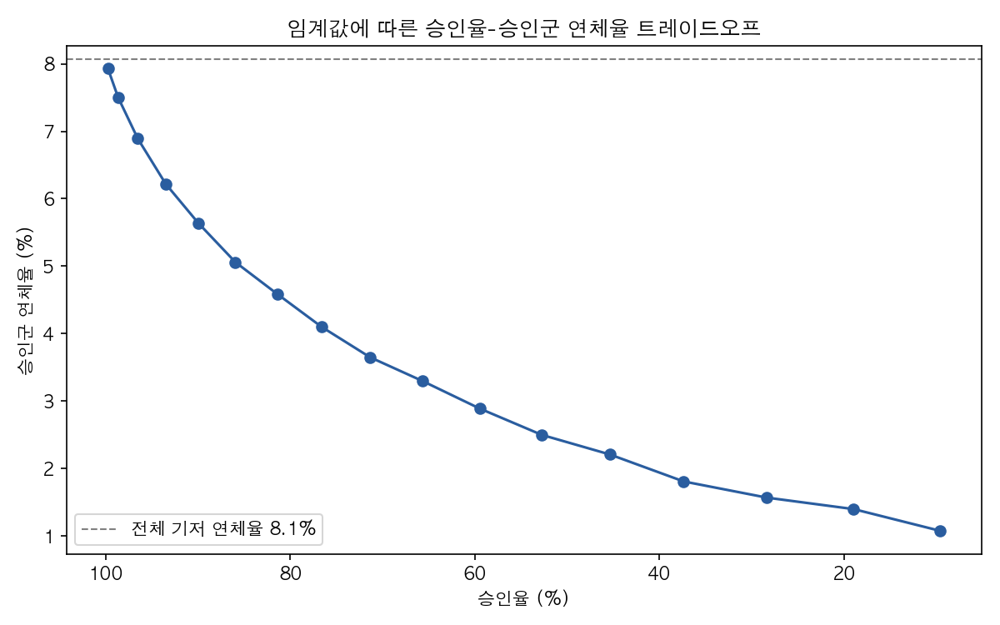

# Phase 9: 임계값별 심사 시나리오 분석

부트캠프 팀 프로젝트(3명)로 진행한 Phase 1~4(모델링)와 이후 개인적으로 확장한
Phase 5~8(서빙·배포·모니터링, 2026.08~09)이 끝난 뒤 추가로 보완한 분석이다.
Phase 4에서
확정한 Lean(A) + LightGBM 모델은 검증 AUC 0.7825를 기록했지만, 실제 심사에 쓸
임계값(threshold)은 정해두지 않았다. 이 문서는 임계값을 바꿔가며 승인율과
연체율이 어떻게 맞바뀌는지 정리하고, 운영 목표별로 쓸 수 있는 임계값을 제시한다.

## 사용한 모델과 데이터

Phase 7(모니터링)에서 만든 held-out 모델(`models/lean_a_lightgbm_holdout_v1.joblib`)과
같은 held-out 데이터(`data/processed/monitoring_holdout.parquet`, 61,503명)를
그대로 재사용했다. 이 모델은 Phase 4와 동일한 레시피(80/20 stratified split,
`random_state=42`, LightGBM 동일 파라미터)로 학습됐지만 학습에 전체 데이터의
80%만 썼고, 이 61,503명은 학습 때 전혀 보지 않은 진짜 held-out이다.

재현 시 이 모델의 held-out AUC는 **0.7833**으로 나왔다. Phase 4가 보고한 검증
AUC(0.7825, 서빙용 전체 80/20 split 기준)와 소수점 셋째 자리까지 완전히 같지는
않다. Phase 4 모델과 이 held-out 모델은 같은 분할 기준(`random_state=42`)으로
학습됐지만 서로 다른 학습 인스턴스라 미세한 차이가 난다. 같은 이유로 임계값
0.5에서의 Recall(0.6775)·Precision(0.1908)도 README §5가 보고하는 Phase 4
수치(Recall 0.6792, Precision 0.1888)와 소수점 셋째 자리까지는 일치하지 않는다.
두 모델 모두 같은 조건으로 학습된 "같은 모델"로 취급할 수 있을 만큼 수치가
근접하고, 방향성 해석에는 차이가 없다.

## 지표 정의

- **승인율**: 임계값 미만(저위험 예측)으로 승인된 비율
- **승인군 연체율**: 승인된 사람 중 실제 TARGET=1 비율
- **거절군 연체율**: 거절된 사람 중 실제 TARGET=1 비율
- **Recall(연체자 포착률)**: 실제 연체자 중 거절로 분류된 비율
- **Precision**: 거절된 사람 중 실제 연체자 비율
- **승인 대출금 중 연체 건 금액 비중**: 승인군의 `AMT_CREDIT` 합계 대비, 그중 실제 연체 건의 `AMT_CREDIT` 합계가 차지하는 비중

가정하지 않은 것: 손실률(LGD), 금리, 회수율 등 금융 가정은 전혀 넣지 않았다.
금액 지표는 "승인 대출금 중 연체 건 금액 비중"까지만 계산하며, 이는 실제
손실액이 아니다.

## 임계값별 전체 결과

| 임계값 | 승인율 | 승인군 연체율 | 거절군 연체율 | Recall | Precision | 승인 대출금 중 연체 건 금액 비중 |
|---|---|---|---|---|---|---|
| 0.10 | 9.63% | 1.08% | 8.82% | 98.71% | 8.82% | 1.06% |
| 0.15 | 18.94% | 1.40% | 9.63% | 96.72% | 9.63% | 1.40% |
| 0.20 | 28.34% | 1.57% | 10.64% | 94.48% | 10.64% | 1.64% |
| 0.25 | 37.36% | 1.81% | 11.81% | 91.60% | 11.81% | 1.84% |
| 0.30 | 45.36% | 2.21% | 12.94% | 87.57% | 12.94% | 2.25% |
| 0.35 | 52.73% | 2.50% | 14.28% | 83.65% | 14.28% | 2.52% |
| 0.40 | 59.45% | 2.89% | 15.66% | 78.69% | 15.66% | 2.92% |
| 0.45 | 65.68% | 3.30% | 17.21% | 73.17% | 17.21% | 3.30% |
| 0.50 | 71.33% | 3.65% | 19.08% | 67.75% | 19.08% | 3.64% |
| 0.55 | 76.58% | 4.10% | 21.07% | 61.13% | 21.07% | 4.05% |
| 0.60 | 81.41% | 4.59% | 23.34% | 53.76% | 23.34% | 4.48% |
| 0.65 | 85.93% | 5.06% | 26.49% | 46.16% | 26.49% | 4.92% |
| 0.70 | 89.95% | 5.64% | 29.83% | 37.12% | 29.83% | 5.44% |
| 0.75 | 93.48% | 6.22% | 34.66% | 28.02% | 34.66% | 5.92% |
| 0.80 | 96.50% | 6.89% | 40.70% | 17.66% | 40.70% | 6.50% |
| 0.85 | 98.63% | 7.50% | 49.17% | 8.34% | 49.17% | 7.02% |
| 0.90 | 99.74% | 7.93% | 63.06% | 1.99% | 63.06% | 7.37% |

기저 연체율(전체 평균)은 8.07%다. 임계값을 낮출수록(더 많이 거절) 승인군
연체율은 떨어지지만 승인율도 함께 떨어지는, 전형적인 트레이드오프 곡선을
그린다.

## 운영 시나리오 3개

| 시나리오 | 임계값 | 승인율 | 승인군 연체율 | Recall | Precision |
|---|---|---|---|---|---|
| 승인율 90% 유지 | 0.70 | 89.95% | 5.64% | 37.12% | 29.83% |
| 승인군 연체율 5% 이하 | 0.60 | 81.41% | 4.59% | 53.76% | 23.34% |
| 연체자 포착률 70% 이상 | 0.45 | 65.68% | 3.30% | 73.17% | 17.21% |

세 시나리오는 서로 다른 우선순위를 보여준다. 승인율을 높게 유지하면(임계값
0.70) 승인군 연체율이 기저치(8.07%)의 약 70% 수준(5.64%)까지만 낮아지고
연체자의 63%를 놓친다. 반대로 연체자를 70% 이상 잡아내려면(임계값 0.45)
신청자의 약 3분의 1을 거절해야 한다. 어느 지점을 쓸지는 모델이 아니라
비즈니스가 감당할 수 있는 승인율 하한과 연체 허용 수준에 달려 있다.

## 한계

- 심사 임계값 0.5를 기본값으로 가정한 기존 README §5의 Precision/Recall과
  이 문서의 0.50 행 수치가 완전히 일치하지 않는 이유는 위 "사용한 모델과
  데이터" 절 참고.
- 금리·손실률(LGD)·회수율을 반영한 실제 기대손실액 계산은 하지 않았다.
- 임계값은 held-out 61,503명 기준으로 산출한 값으로, 실제 운영 데이터의
  시간 경과에 따른 분포 변화(Phase 7 모니터링 참고)에 따라 주기적 재산출이
  필요하다.

재현: `python3 scripts/phase9_threshold_analysis.py`
