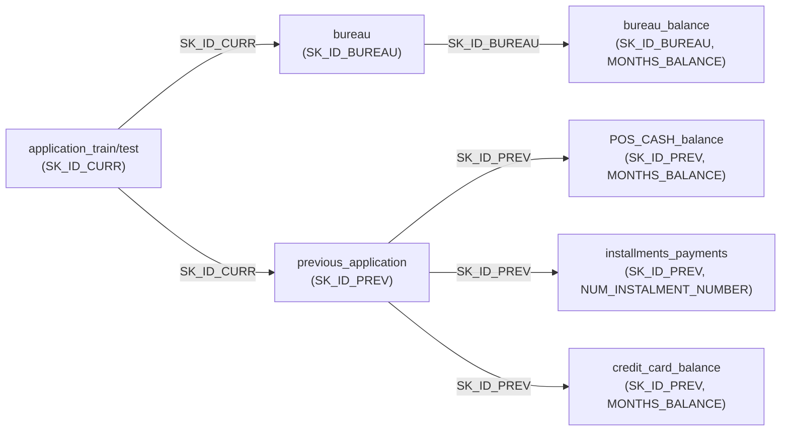
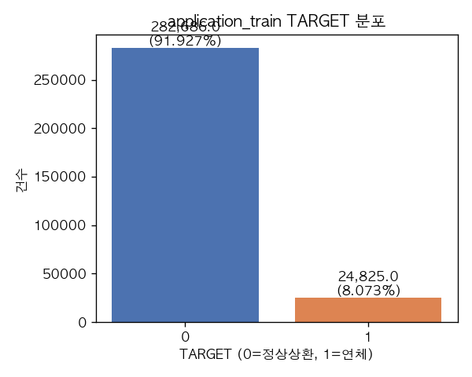
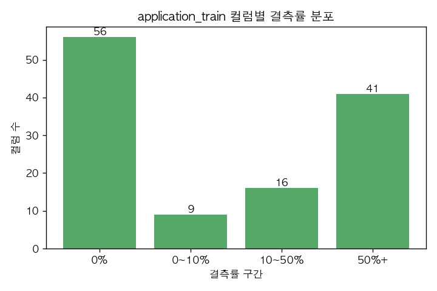

# 원데이터 점검 (1단계)

연체 위험 기반 대출 승인 기준 설계 (Loan Approval Risk Scoring) — v2 재분석

데이터 출처: Home Credit Default Risk (Kaggle, 해외 소비자금융사 공개 대출 데이터)

> 이 문서는 데이터 품질과 구조만 점검한다. TARGET(연체 여부)과 다른 변수 사이의 관계는 계산하지 않았으며, TARGET은 자체 분포만 확인했다.

재현 코드: [`v2/scripts/01_data_audit.py`](../scripts/01_data_audit.py) · 원본 수치: [`audit_results.json`](audit_results.json)

---

## 발견된 문제 요약

| 심각도 | 문제 | 분석에 미치는 영향 | 처리 제안 |
|---|---|---|---|
| 상 | bureau_balance의 54.9%(942,074/1,716,428건)가 bureau와 연결되지 않는 신용(SK_ID_BUREAU)이다 | bureau_balance 단독으로는 신청자 단위 월별 이력을 절반밖에 못 구성 — bureau 기준으로 집계한 파생변수는 그만큼 커버리지가 낮음 | bureau_balance를 쓸 때는 orphan 비율을 명시하고, bureau 기준 집계와 bureau_balance 기준 집계의 모집단이 다름을 구분 |
| 상 | credit_card_balance의 94.4%(1,577,279/1,670,214건)가 previous_application과 연결되지 않는 신청(SK_ID_PREV)이다 | credit_card_balance를 previous_application에 조인하면 거의 모든 신용카드 이력이 유실됨 | credit_card_balance는 SK_ID_CURR로 직접 연결해 쓰고, previous_application 조인 경로는 쓰지 않는다 |
| 상 | 주택 건물 정보 47개 컬럼 중 다수가 결측률 50~70%이며, AVG/MODE/MEDI 세 버전이 동일 정보를 반복 기록 | 결측 보완(imputation) 전략 없이 쓰면 분석 대상이 신청자의 절반 이하로 줄어듦; 3개 버전 중복 사용 시 다중공선성 위험 | 결측 처리 전략을 별도로 정하고, AVG/MODE/MEDI 중 하나만 대표로 선택하거나 결측 자체를 "정보 없음" 신호로 활용 |
| 중 | DAYS_EMPLOYED에 365243(약 1000년)이라는 특수값이 55,374건(18.0%) 있다 | 그대로 쓰면 "1000년간 재직"이라는 비현실적 값이 평균·분포를 왜곡함 | 365243을 결측(NaN) 또는 별도 플래그("무직/연금수급자 특수값")로 치환 |
| 중 | previous_application의 DAYS_FIRST_DRAWING/FIRST_DUE/LAST_DUE/TERMINATION에도 365243이 다수(최대 93,864~934,444건) 존재 | 날짜 차이 계산 시 극단값으로 왜곡 | 동일하게 365243을 결측으로 치환 후 사용 |
| 중 | previous_application의 RATE_INTEREST_PRIMARY/PRIVILEGED 결측률 99.6%, AMT_DOWN_PAYMENT·RATE_DOWN_PAYMENT 결측률 53.6% | 금리 관련 변수는 실질적으로 분석에 쓸 수 없음 | 금리 컬럼은 분석 대상에서 제외하거나 "결측=정보 없음" 자체를 변수로만 활용 |
| 중 | 범주형 특수값 XNA/XAP/Unknown이 여러 컬럼에 존재 (예: previous_application.CODE_REJECT_REASON의 XAP 1,353,093건, NAME_GOODS_CATEGORY의 XNA 950,809건) | "해당없음(XAP)"과 "정보없음(XNA)"이 섞여 있어 그대로 두면 하나의 범주로 과대 집계됨 | XAP(해당없음)과 XNA(정보없음)를 구분해서 처리; 특히 previous_application은 이 두 값이 대부분의 행을 차지하므로 거절·취소 건의 의미를 꼼꼼히 분리 |
| 중 | CODE_GENDER에 XNA 4건, NAME_FAMILY_STATUS에 Unknown 2건 | 건수는 적지만 성별/가족상태 분석 시 예외 처리 필요 | 극소수이므로 결측 처리 또는 최빈값 대체 |
| 하 | 10개 금융기관 테이블 전부에서 "완전 중복 행"은 0건 (최초 집계 시 DuckDB `GROUP BY ALL` 구문 오류로 전수 중복처럼 보였으나 재계산 후 0건으로 정정) | 없음 — 데이터 자체는 깨끗함 | 재현 스크립트에 수정된 질의를 반영함(본 보고서 수치는 정정된 값) |
| 하 | bureau.AMT_ANNUITY 결측률 71.5%, credit_card_balance의 AMT_DRAWINGS_ATM/OTHER/POS_CURRENT 등 결측률 약 19.5% | 일부 파생 집계 시 표본이 줄어듦 | 결측 자체가 "해당 거래 없음"을 뜻할 가능성이 높아 0으로 대체하는 편이 합리적일 수 있음(단, 가정이므로 다음 단계에서 재검증) |
| 하 | application_train/test에서 FLAG_MOBIL, FLAG_DOCUMENT_2/4/7/10/12/17/19/20/21 등 10개 컬럼이 99.9% 이상 동일한 값(상수에 가까움) | 변별력이 거의 없는 컬럼 | 모델링 단계에서 제거 후보로 기록(이번 단계에서는 삭제하지 않음) |
| 하 | 절대 날짜(연/월/일) 컬럼이 전혀 없음 — 모든 시간 변수가 신청일 기준 상대 일수(DAYS_*) | 특정 연도·계절 효과, 시간순 검증(time-based split)이 불가능 | 상대 일수만으로 가능한 분석(최근성, 기간)과 불가능한 분석(계절성, 거시경제 연동)을 구분해 보고 |

---

## 1-1. 파일 기본 정보

| 테이블 | 파일 크기 | 행 수 | 열 수 | 인코딩/읽기 오류 | 분석 단위(grain) |
|---|---|---|---|---|---|
| application_train | 158.4MB | 307,511 | 122 | 오류 없음 | 대출 신청 1건 = 신청자 1명 (SK_ID_CURR 1개당 1행) |
| application_test | 25.3MB | 48,744 | 121 | 오류 없음 | 대출 신청 1건 = 신청자 1명 (TARGET 없음, 예측 대상) |
| bureau | 162.1MB | 1,716,428 | 17 | 오류 없음 | 신청자가 타 금융기관에 보유한 과거/현재 신용 1건 (SK_ID_BUREAU 1개당 1행) |
| bureau_balance | 358.2MB | 27,299,925 | 3 | 오류 없음 | bureau의 각 신용(SK_ID_BUREAU)에 대한 월별(MONTHS_BALANCE) 상태 스냅샷 1행 |
| previous_application | 386.2MB | 1,670,214 | 37 | 오류 없음 | 신청자의 과거 Home Credit 대출 신청 1건 (SK_ID_PREV 1개당 1행) |
| POS_CASH_balance | 374.5MB | 10,001,358 | 8 | 오류 없음 | previous_application의 POS/현금대출에 대한 월별 상태 스냅샷 1행 |
| installments_payments | 689.6MB | 13,605,401 | 8 | 오류 없음 | previous_application의 분할상환 회차별 1행 |
| credit_card_balance | 404.9MB | 3,840,312 | 23 | 오류 없음 | previous_application의 신용카드 대출에 대한 월별 잔액 스냅샷 1행 |

컬럼 설명 파일(`HomeCredit_columns_description.csv`)은 로컬에 존재했으며, 인코딩이 UTF-8이 아닌 **cp1252(latin-1 계열)**로 확인되어 해당 인코딩으로 읽었다. Kaggle API 재요청은 필요 없었다.

---

## 2. 테이블 구조 요약

### 2-1. 키 유일성

| 테이블 | 기본키 | 전체 행 | 고유 키 수 | 중복 여부 |
|---|---|---|---|---|
| application_train | SK_ID_CURR | 307,511 | 307,511 | 없음 |
| application_test | SK_ID_CURR | 48,744 | 48,744 | 없음 |
| bureau | SK_ID_BUREAU | 1,716,428 | 1,716,428 | 없음 |
| previous_application | SK_ID_PREV | 1,670,214 | 1,670,214 | 없음 |

application_train과 application_test의 SK_ID_CURR는 **겹치지 않는다**(겹침 0건) — 서로 다른 신청자 집합이다.

### 2-2. 연결 구조



### 2-3. 고아 레코드 (양방향)

"자식→부모 고아"는 자식 테이블의 키가 부모 테이블에 없는 비율(application_train만 부모로 사용), "부모 미매칭"은 부모 테이블의 키 중 해당 자식 테이블에 전혀 등장하지 않는 비율이다.

| 관계 | 자식 전체 행 | 자식→부모 고아 행 | 고아 비율 | 부모 고유 키 수 | 부모 미매칭 키 수 | 부모 미매칭 비율 |
|---|---|---|---|---|---|---|
| bureau → application_train | 1,716,428 | 251,103 | 14.63% | 307,511 | 44,020 | 14.32% |
| bureau_balance → bureau | 27,299,925 | 3,120,184 | 11.43% | 1,716,428 | 942,074 | **54.89%** |
| previous_application → application_train | 1,670,214 | 256,513 | 15.36% | 307,511 | 16,454 | 5.35% |
| POS_CASH_balance → previous_application | 10,001,358 | 340,561 | 3.41% | 1,670,214 | 771,311 | 46.18% |
| installments_payments → previous_application | 13,605,401 | 1,250,826 | 9.19% | 1,670,214 | 711,309 | 42.59% |
| credit_card_balance → previous_application | 3,840,312 | 1,082,816 | 28.20% | 1,670,214 | **1,577,279** | **94.44%** |

* "bureau → application_train" 고아(14.63%)는 application_test의 신청자이기 때문일 가능성이 높다. 실제로 bureau와 previous_application을 **train+test 합친 집합**과 비교하면 고아 행이 **0건**이다(아래 참고). 즉 bureau/previous_application은 train/test 신청자를 모두 포괄하도록 구성되어 있다.
* bureau_balance의 54.89% 부모 미매칭은 bureau 쪽 신용 중 절반 이상이 월별 상태 기록(bureau_balance)을 갖지 않는다는 뜻이다. 데이터 오류가 아니라 **원천적으로 월별 상태를 제공하지 않는 신용 유형이 많다**고 해석하는 것이 합리적이다.
* credit_card_balance의 94.44% 부모 미매칭은 Home Credit 신용카드를 발급받은 신청자가 전체 과거 신청의 극히 일부(약 5.6%)뿐임을 뜻한다. 신용카드 보유 자체가 드문 사건이다.

| 비교 | 고아 행 | 전체 행 | 비율 |
|---|---|---|---|
| bureau vs (application_train ∪ application_test) | 0 | 1,716,428 | 0.0% |
| previous_application vs (application_train ∪ application_test) | 0 | 1,670,214 | 0.0% |

---

## 3. 이력 보유 현황 (application_train 신청자 307,511명 기준)

| 이력 종류 | 이력 있는 신청자 수 | 비율 |
|---|---|---|
| 타 금융기관 이력 (bureau) | 263,491 | 85.69% |
| 과거 Home Credit 신청 이력 (previous_application) | 291,057 | 94.65% |
| 분할상환 기록 (installments_payments) | 289,406 | 94.11% |
| POS/현금대출 상태 (POS_CASH_balance) | 286,967 | 93.32% |
| 카드 잔액 (credit_card_balance) | 77,934 | 25.34% |
| **어떤 이력도 전혀 없음** | **2,470** | **0.80%** |

* 신규/이력 부족 고객(모든 이력이 전혀 없는 신청자)은 **2,470명(0.80%)**으로 소수다.
* 반대로 94% 이상이 과거 Home Credit 신청 이력과 분할상환 기록을 가지고 있어, 이 데이터는 **완전 신규 고객보다는 재이용 고객이 압도적으로 많은 모집단**이다. 이는 "신규 고객에게도 적용 가능한 심사 기준"을 설계할 때 이 데이터만으로는 한계가 있음을 시사한다.
* credit_card_balance 이력 보유율(25.34%)이 다른 이력보다 낮은 것은 위 2-3에서 확인한 대로 신용카드 자체 보급률이 낮기 때문이다.

---

## 4. TARGET 정의와 분포

**원문(Kaggle 컬럼 설명)**:
> "Target variable (1 - client with payment difficulties: he/she had late payment more than X days on at least one of the first Y installments of the loan in our sample, 0 - all other cases)"

**한국어 해설**: TARGET은 1이면 "상환 곤란 고객"으로, 전체 할부 중 처음 Y회차 이내에 X일을 초과하는 연체가 한 번이라도 있었던 경우를 뜻한다. 0은 그 외 모든 경우다. (X, Y의 구체적 숫자는 Kaggle 설명에 공개되어 있지 않다.)

**train 분포**:

| TARGET | 건수 | 비율 |
|---|---|---|
| 0 (정상상환) | 282,686 | 91.93% |
| 1 (연체) | 24,825 | 8.07% |



application_test에는 TARGET 컬럼이 **존재하지 않는다**(예측 대상이므로 당연한 결과). 이번 단계에서는 TARGET과 다른 변수의 관계는 계산하지 않았다 — 분포만 확인했다.

---

## 5. 데이터 품질

### 5-1. 결측률 구간별 컬럼 수

| 테이블 | 0% | 0~10% | 10~50% | 50%+ | 전체 컬럼 수 |
|---|---|---|---|---|---|
| application_train | 56 | 9 | 16 | 41 | 122 |
| application_test | 57 | 7 | 28 | 29 | 121 |
| bureau | 10 | 2 | 3 | 2 | 17 |
| bureau_balance | 3 | 0 | 0 | 0 | 3 |
| previous_application | 22 | 1 | 10 | 4 | 37 |
| POS_CASH_balance | 6 | 2 | 0 | 0 | 8 |
| installments_payments | 6 | 2 | 0 | 0 | 8 |
| credit_card_balance | 14 | 2 | 7 | 0 | 23 |



application_train에서 결측률 50% 이상인 41개 컬럼은 대부분 주택 건물 정보(APARTMENTS_*, BASEMENTAREA_* 등)와 EXT_SOURCE_1이다. 상세 결측률은 [`audit_results.json`](audit_results.json)의 `missing_summary`에 전수 기록되어 있다.

### 5-2. 상수·거의 상수인 컬럼 (동일 값이 99.9% 이상)

| 테이블 | 컬럼 | 최다값 비율 |
|---|---|---|
| application_train | FLAG_MOBIL | 100.0% |
| application_train | FLAG_DOCUMENT_2 | 99.996% |
| application_train | FLAG_DOCUMENT_4 | 99.992% |
| application_train | FLAG_DOCUMENT_7 | 99.981% |
| application_train | FLAG_DOCUMENT_10 | 99.998% |
| application_train | FLAG_DOCUMENT_12 | 99.999% |
| application_train | FLAG_DOCUMENT_17 | 99.973% |
| application_train | FLAG_DOCUMENT_19 | 99.94% |
| application_train | FLAG_DOCUMENT_20 | 99.949% |
| application_train | FLAG_DOCUMENT_21 | 99.967% |
| bureau | CREDIT_CURRENCY | 99.918% |

application_test에서도 거의 동일한 컬럼 집합이 상수에 가깝다(FLAG_MOBIL, FLAG_DOCUMENT_2/4/7/10/12/13/14/15/16/17/19/20/21). bureau_balance/previous_application/POS_CASH_balance/installments_payments/credit_card_balance에는 상수에 가까운 컬럼이 없었다.

### 5-3. 완전 중복 행

8개 테이블 전부에서 완전 중복 행은 **0건**이다. (최초 집계 시 DuckDB의 `GROUP BY ALL` 구문이 SELECT 목록에 다른 컬럼이 없어 전체를 한 그룹으로 묶는 문제가 있어 "거의 모든 행이 중복"으로 잘못 나왔다 — 모든 컬럼을 명시한 `GROUP BY`로 재계산하여 0건으로 정정했다.)

### 5-4. 이상값

**DAYS_ 컬럼** (신청일 기준 상대 일수, 모두 0 이하가 정상):

| 테이블.컬럼 | min | max | 양수 건수 | 365243 건수 |
|---|---|---|---|---|
| application_train.DAYS_BIRTH | -25,229 | -7,489 | 0 | 0 |
| application_train.DAYS_EMPLOYED | -17,912 | **365,243** | **55,374** | **55,374** |
| application_train.DAYS_REGISTRATION | -24,672 | 0 | 0 | 0 |
| application_train.DAYS_ID_PUBLISH | -7,197 | 0 | 0 | 0 |
| application_train.DAYS_LAST_PHONE_CHANGE | -4,292 | 0 | 0 | 0 |
| bureau.DAYS_CREDIT | -2,922 | 0 | 0 | 0 |
| bureau.DAYS_CREDIT_ENDDATE | -42,060 | 31,199 | 602,603 | 0 |
| bureau.DAYS_CREDIT_UPDATE | -41,947 | 372 | 17 | 0 |
| previous_application.DAYS_FIRST_DRAWING | -2,922 | 365,243 | 934,444 | 934,444 |
| previous_application.DAYS_FIRST_DUE | -2,892 | 365,243 | 40,645 | 40,645 |
| previous_application.DAYS_LAST_DUE_1ST_VERSION | -2,801 | 365,243 | 318,256 | 93,864 |
| previous_application.DAYS_LAST_DUE | -2,889 | 365,243 | 211,221 | 211,221 |
| previous_application.DAYS_TERMINATION | -2,874 | 365,243 | 225,913 | 225,913 |

DAYS_EMPLOYED의 365243은 "재직일수를 알 수 없음/해당없음"(주로 연금수급자·무직)을 나타내는 Kaggle의 관례적 특수값으로 보인다. previous_application의 여러 DAYS_* 컬럼에도 동일 특수값이 다수 존재한다. bureau.DAYS_CREDIT_ENDDATE는 신용 만기일(미래일 수 있음)이라 양수 자체는 정상이다.

**범주형 특수값(XNA/XAP/Unknown)**:

| 테이블.컬럼.값 | 건수 |
|---|---|
| application_train.CODE_GENDER.XNA | 4 |
| application_train.NAME_FAMILY_STATUS.Unknown | 2 |
| application_train.ORGANIZATION_TYPE.XNA | 55,374 |
| application_test.ORGANIZATION_TYPE.XNA | 9,274 |
| bureau.CREDIT_TYPE.Unknown type of loan | 555 |
| previous_application.NAME_CONTRACT_TYPE.XNA | 346 |
| previous_application.NAME_CASH_LOAN_PURPOSE.XNA | 677,918 |
| previous_application.NAME_CASH_LOAN_PURPOSE.XAP | 922,661 |
| previous_application.NAME_PAYMENT_TYPE.XNA | 627,384 |
| previous_application.CODE_REJECT_REASON.XNA | 5,244 |
| previous_application.CODE_REJECT_REASON.XAP | 1,353,093 |
| previous_application.NAME_CLIENT_TYPE.XNA | 1,941 |
| previous_application.NAME_GOODS_CATEGORY.XNA | 950,809 |
| previous_application.NAME_PORTFOLIO.XNA | 372,230 |
| previous_application.NAME_PRODUCT_TYPE.XNA | 1,063,666 |
| previous_application.NAME_SELLER_INDUSTRY.XNA | 855,720 |
| previous_application.NAME_YIELD_GROUP.XNA | 517,215 |
| POS_CASH_balance.NAME_CONTRACT_STATUS.XNA | 2 |

previous_application은 XNA(정보없음)·XAP(해당없음)가 거의 모든 범주형 컬럼에서 전체 행의 상당 비율(많은 경우 50% 이상)을 차지한다. 이는 현금대출(Cash loans)과 소비재할부(Consumer loans)의 속성 컬럼 구성이 달라서 발생하는 구조적 결과로 보인다(예: 현금대출에는 상품 카테고리가 "해당없음").

**금액(AMT_) 컬럼**: application_train/test의 AMT_INCOME_TOTAL, AMT_CREDIT, AMT_ANNUITY, AMT_GOODS_PRICE는 **음수가 전혀 없다**. 다만 bureau.AMT_CREDIT_SUM_DEBT(-4,705,600 ~ 170,100,000), bureau.AMT_CREDIT_SUM_LIMIT, credit_card_balance.AMT_BALANCE/AMT_RECEIVABLE_PRINCIPAL/AMT_RECIVABLE/AMT_TOTAL_RECEIVABLE 등에는 소수의 음수 값이 있다(과오납·환불 등으로 해석 가능). application_train.AMT_INCOME_TOTAL의 최댓값은 117,000,000으로 상위 0.1%(900,000) 대비 극단적으로 크다 — 단일 이상치로 보인다. 전체 극단값은 [`audit_results.json`](audit_results.json)의 `amt_anomalies`에 기록했다.

**성별 등 범주형**: CODE_GENDER는 F 202,448 / M 105,059 / XNA 4건으로, XNA은 극소수이며 성별 미기재로 보인다.

**단위 문제**: 금액 컬럼의 화폐 단위는 Kaggle 컬럼 설명에 명시되어 있지 않다(현지화 익명 처리로 추정). 일수 컬럼은 공통적으로 "신청일(0) 기준 상대 일수"이며, 과거는 음수, 미래(만기 등)는 양수로 기록된다.

### 5-5. 시간 정보와 누수 위험

* **절대 날짜 컬럼은 전혀 없다** — 모든 테이블에서 DATE/TIMESTAMP 타입 컬럼이 0개로 확인됐다. 이 때문에 **시간순 검증(time-based train/test split)과 계절성 분석은 이 데이터만으로 불가능**하다. WEEKDAY_APPR_PROCESS_START(요일)는 있지만 특정 연도의 요일과 매칭할 절대 기준이 없다.
* **신청 이후 정보 혼입 가능성**: POS_CASH_balance/credit_card_balance/bureau_balance의 MONTHS_BALANCE가 양수(미래)인 행은 **0건**으로 확인됐다 — 이 세 테이블은 신청일 이후 정보가 섞여 있지 않다.
* previous_application의 DAYS_DECISION, DAYS_FIRST_DRAWING, DAYS_FIRST_DUE, DAYS_LAST_DUE, DAYS_TERMINATION 중 365243을 제외하고 실제 양수(미래) 값이 있는 컬럼은 **DAYS_LAST_DUE_1ST_VERSION 1개뿐(224,392건)**이다. 이는 "최초 계획상 마지막 상환일"이 신청일 이후 미래 시점인 것이 당연하므로(할부 계획 자체가 미래 날짜를 가리킴) 데이터 오류가 아니라 **정의상 자연스러운 미래 날짜**로 판단된다.
* **누수 의심 변수 후보**: previous_application의 DAYS_LAST_DUE, DAYS_TERMINATION(실제 종료/상환 완료일)은 "신청 시점에는 아직 알 수 없는 정보"일 가능성이 있다. 이 변수들을 신청 시점 심사 모델에 쓰면 미래 정보 누수가 될 수 있으므로, 다음 단계(가설 수립)에서 "신청 시점에 이미 알 수 있는 정보"와 "대출 집행 후에만 알 수 있는 정보"를 명확히 구분해야 한다.

---

## 6. 건너뛴 항목과 이유

* Kaggle API 재다운로드: 불필요 — 로컬 `data/raw/`에 8개 CSV와 컬럼 설명 파일이 모두 존재했다.
* TARGET과 변수의 상관관계, 그룹별 연체율, 통계 검정: 작업 지시에 따라 전부 수행하지 않음(가설은 이 보고서를 본 뒤 다음 단계에서 수립).
* 모델링, Feature Engineering: 작업 지시에 따라 수행하지 않음.

---

## 재현 방법

```bash
python3 -I v2/scripts/01_data_audit.py
```

DuckDB로 8개 원본 CSV를 직접 스캔하며, 결과는 `v2/docs/audit_results.json`과 `v2/docs/figures/*.png`에 저장된다.
