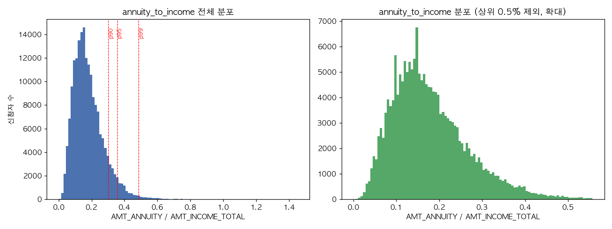
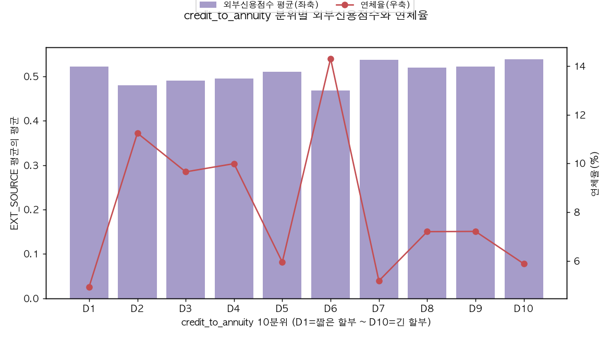
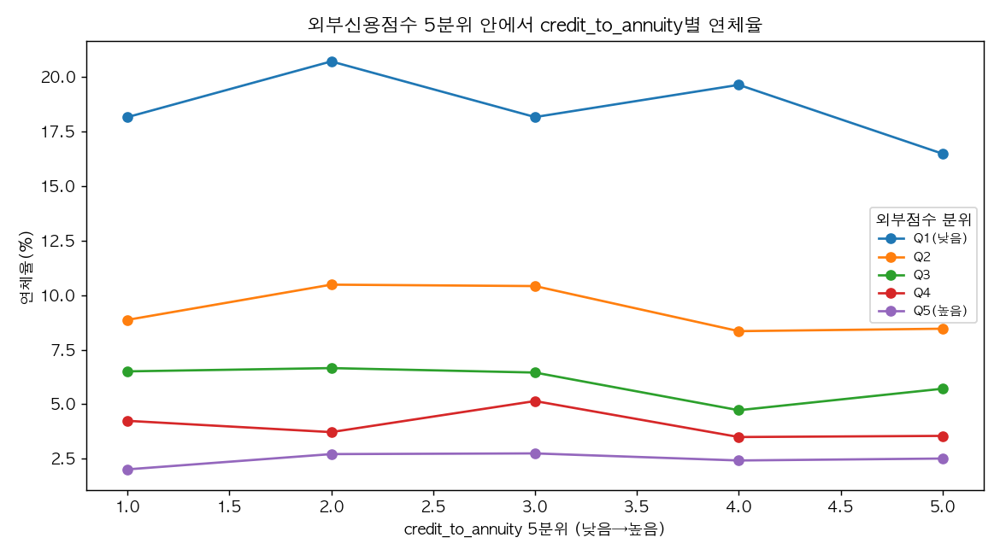

# H2 기각 원인 탐색 (4단계 1절)

연체 위험 기반 대출 승인 기준 설계 (Loan Approval Risk Scoring) — v2 재분석

재현 코드: [`v2/scripts/06_h2_followup.py`](../scripts/06_h2_followup.py) · 원본 수치: [`h2_followup_results.json`](h2_followup_results.json)

> **이 문서는 결과를 단정하지 않는다.** H2(소득 대비 상환 부담)가 3단계에서 기각(IV=0.006)된 이유로 "기존 심사가 이미 부담이 큰 신청자를 걸러냈다"는 가설을 정황 증거로만 탐색한다. 학습 세트만 사용했다.

---

## 관찰 사실

### 1. annuity_to_income 분포에 급격한 절단은 없다

| 백분위 | 값 |
|---|---|
| p50 | 0.163 |
| p90 | 0.302 |
| p95 | 0.355 |
| p99 | 0.485 |
| p99.9 | 0.729 |
| **최댓값** | **1.452** |

히스토그램은 0.15 부근에서 부드럽게 봉우리를 이루고 오른쪽으로 긴 꼬리를 그리며 서서히 0에 수렴한다. 특정 값(예: 0.5) 근처에서 분포가 갑자기 끊기는 벽이나 비정상적인 몰림은 관찰되지 않았다. 최댓값이 1.452(연 상환액이 소득의 145%)까지 존재한다는 점도 "특정 비율 이상은 아예 승인하지 않는다"는 식의 **하드 컷오프가 없음**을 시사한다. 단, 0.01 단위로 반올림했을 때 상위 몰림 구간(0.10~0.19 사이)이 전체의 약 46%를 차지해, 이 구간에서 신청자가 밀집돼 있다는 점은 확인했다(점진적 쏠림이지 절단은 아니다).

### 2. 할부 기간(credit_to_annuity)이 길수록 외부 점수가 높은 고객에 몰려 있는 정도는 약하다

credit_to_annuity와 ext_source_mean의 **상관계수는 0.088**로 매우 약한 양의 상관에 그쳤다.

10분위별 외부점수 평균(0.468~0.539)은 분위가 올라갈수록 뚜렷이 커지는 패턴이 아니라 좁은 범위 안에서 오르내린다. 반면 연체율은 분위 사이를 크게 오르내린다(D1 4.9% → D6 14.3% → D7 4.0%) — 이는 매끄러운 선형 관계가 아니라, **할부 개월수가 특정 "상품 플랜"(예: 12/20/24/36개월 등 정형화된 회차)에 몰려 있어 분위 경계가 그 플랜 전환점과 겹치며 생기는 톱니 패턴**으로 보인다(round-number 효과 가능성).

### 3. 외부 점수를 통제하면 credit_to_annuity의 (역방향) 신호가 상당 부분 약해진다

전체 모집단에서는 credit_to_annuity가 클수록(할부가 길수록) 연체율이 낮아지는 역방향 패턴(3단계 보고서의 "방향 반대" 발견)이 뚜렷했지만, **외부 신용점수 5분위 안으로 나누면 이 패턴이 대부분 사라지거나 뒤섞인다**. Spearman ρ는 분위별로 −0.3, −0.6, −0.8, −0.6, +0.2로 부호와 크기가 들쭉날쭉하며, 그래프 상으로도 각 분위 선이 뚜렷한 기울기 없이 좁은 범위 안에서 오르내린다. 즉 전체 모집단에서 보였던 "긴 할부=안전"이라는 관계의 상당 부분이 **외부 점수 차이로 설명되는 부분과 겹쳐 있을 가능성**이 있다.

---

## 가능한 해석

* **"이미 걸러졌다" 가설과 부분적으로 부합**: 외부 점수를 통제하면 credit_to_annuity의 단독 신호가 약해진다는 점(관찰 3)은, 기존 심사(또는 상품 설계)가 외부 신용점수가 낮은 고객에게는 애초에 긴 할부 상품을 잘 제공하지 않았을 가능성과 들어맞는다. 다만 상관계수 자체는 약해서(0.088) "점수가 할부기간을 전적으로 결정한다"고 보기는 어렵다.
* **annuity_to_income 자체는 하드 필터링의 흔적이 약하다**: 분포에 절단이 없고 최댓값도 소득의 145%까지 열려 있다는 점(관찰 1)은, 적어도 "연 상환액/소득 비율"이라는 단순 지표 하나만으로 걸러내는 명시적 규칙은 이 데이터 생성 과정에 없었거나 약했음을 시사한다. 즉 H2가 약한 이유가 "이미 하드 필터링됐기 때문"이라기보다는, **단순 비율 하나로는 포착되지 않는 더 복잡한 심사 로직**(소득 수준, 고용 형태, 담보 등 복합 판단)이 이미 작동했을 가능성이 더 커 보인다.
* **할부기간(credit_to_annuity)의 역방향은 상품설계/선별이 혼재된 결과로 보인다**: 관찰 2의 톱니 패턴은 순수한 "길수록 안전"이라는 선형 인과가 아니라, 특정 할부 플랜 상품군 자체의 특성(예: 장기 할부는 고가 내구재 소비재대출에 많고, 저가 소액 단기 상품은 다른 위험 프로파일을 가질 수 있음)이 섞여 있을 가능성을 보여준다.

## 한계

* 이 분석은 상관·조건부 평균 비교에 그치며, 인과관계를 증명하지 않는다. "기존 심사가 걸러냈다"는 원인을 직접 관찰할 수 있는 심사 로그나 거절 사유 데이터는 이 데이터셋에 없다.
* credit_to_annuity를 "할부기간"의 대용(proxy)으로 썼지만, 실제로는 AMT_CREDIT÷AMT_ANNUITY이므로 대출금액과 연이자율 구성에 따라서도 달라질 수 있어 완전한 "회차 수" 대용은 아니다.
* 외부 점수 5분위 통제는 선형·단조적 통제가 아니라 구간별 평균 비교이므로, 분위 경계 효과(위 2번 관찰의 톱니 패턴과 유사한 문제)가 여전히 남아있을 수 있다.
* 표본은 학습 세트(60%)로 제한했으며, 검증·최종평가 세트에서 같은 패턴이 재현되는지는 확인하지 않았다(지시사항에 따라 이번 절에서는 학습 세트만 사용).
