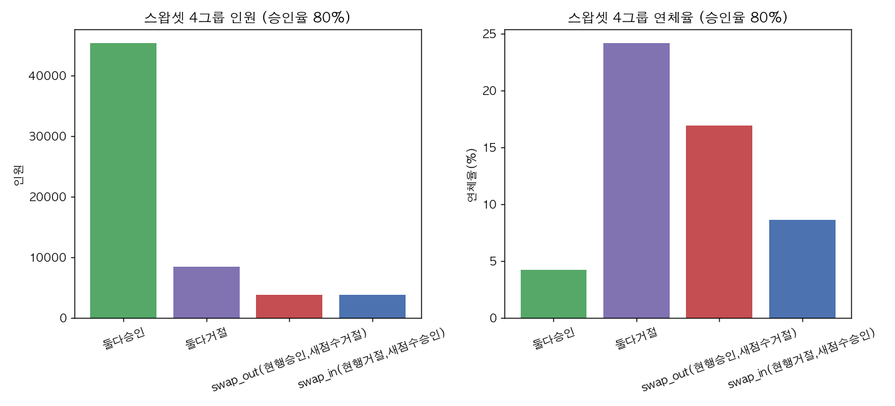

# 최종 평가 (4단계 3절)

연체 위험 기반 대출 승인 기준 설계 (Loan Approval Risk Scoring) — v2 재분석

재현 코드: [`v2/scripts/08_final_evaluation.py`](../scripts/08_final_evaluation.py) · 원본 수치: [`final_evaluation_results.json`](final_evaluation_results.json)

> **최종평가(holdout) 세트 61,503명을 이 문서 작성을 위해 처음 열었다.** 모든 모델·변수·설정은 [`06_modeling.md`](06_modeling.md)에서 검증 세트로 이미 확정됐으며, 이 문서의 결과를 보고 모델/변수/설정을 다시 바꾸지 않았다. 최종 선택 모델: **LightGBM(나이 제외, 23개 변수)**. Champion은 "실제 회사의 기존 심사 점수가 아니라, 외부 점수만 쓰는 심사를 가정한 대용 기준"이다.

---

## 판정 요약

| 가설 | 판정 | 근거 |
|---|---|---|
| **H6 (현행 기준 대비 개선)** | **채택** | 승인율 70/80/90% 모두에서 새 점수의 연체율 감소폭 95% CI 하한이 0보다 큼(각각 0.592/0.524/0.327%p) |
| **H7 (수익 기준 최적 지점)** | **채택** | r×LGD 6개 조합 전부(6/6)에서 새 점수의 이익 최대 지점이 승인율 50~100% 범위의 내부(50%도 100%도 아님)에 위치 |

## 결론 후보 문장 3개

1. **"전원 승인 시 연체율 8.07% → 외부점수 기준(승인율 80%) 5.26% → 새 점수(승인율 80%) 4.61%로, 같은 승인율에서 연체율을 0.65%p(상대 12.3%) 더 낮췄다."**
2. **"현행 기준이 승인율 80%에서 달성하는 연체율(5.26%)을 새 점수는 승인율 86%에서도 달성할 수 있어, 같은 위험 수준에서 승인율을 6%p(95% CI 5~7%p) 더 늘릴 여지가 있다."**
3. **"수익 가정 6개 조합(이자수익률 10~30% × 손실률 40~60%) 전부에서 새 점수의 최적 승인율이 현행보다 낮은 지점(더 엄격한 승인)에서 이익이 극대화됐고, 특히 저수익·고손실 조합(r=10%, LGD=60%)에서는 이익 지수를 현행 대비 +6.0(지수 114.0→120.0) 끌어올렸다."**

---

## 1. 기본 성능

| 모델 | AUC | KS | Gini |
|---|---|---|---|
| Champion(외부점수 대용) | 0.7272 | 0.3387 | 0.4543 |
| **새 점수(LightGBM, 나이 제외)** | **0.7698** | **0.4056** | **0.5395** |

최종평가 세트 기저 연체율(전원 승인 기준): **8.073%** (61,503명 중 연체 건수는 학습·검증과 동일한 비율 — 층화추출 설계대로 재현됨)

두 모델 모두 검증 세트 성능(Champion 0.7225, 새 점수 0.7680)과 최종평가 세트 성능이 거의 일치해(새 점수 AUC 차이 0.0018) **과적합이나 분할 간 분포 차이로 인한 성능 저하가 관찰되지 않았다.**

---

## 2. H6. 현행 기준 대비 개선 (스왑셋 분석)

### 2-1. 같은 승인율에서 연체율

| 승인율 | 현행 연체율 | 새 점수 연체율 | 차이(%p) | 상대 감소율 | 차이 95% CI |
|---|---|---|---|---|---|
| 70% | 4.522% | 3.798% | **0.725%p** | 16.02% | [0.592, 0.871] |
| 80% | 5.256% | 4.610% | **0.646%p** | 12.30% | [0.524, 0.768] |
| 90% | 6.242% | 5.821% | **0.421%p** | 6.74% | [0.327, 0.529] |

세 승인율 모두 95% CI 하한이 0보다 크다 — 부트스트랩 1,000회(복원추출, seed=42) 기준.

### 2-2. 같은 연체율에서 승인율

현행 기준의 승인율 80% 지점 연체율(5.256%)을 새 점수는 **승인율 86%**에서도 달성한다 (같은 위험 수준에서 승인율 **+6.0%p**, 95% CI [5.0, 7.0]%p).

### 2-3. 스왑셋 표 (승인율 80%)

| 그룹 | 인원 | 비율 | 연체율 |
|---|---|---|---|
| 둘 다 승인 | 45,369 | 73.77% | 4.269% |
| 둘 다 거절 | 8,468 | 13.77% | 24.185% |
| swap-out (현행 승인 → 새 점수 거절) | 3,833 | 6.23% | 16.932% |
| swap-in (현행 거절 → 새 점수 승인) | 3,833 | 6.23% | 8.636% |

**해석**: swap-out 그룹(현행은 승인했지만 새 점수는 거절한 3,833명)의 연체율은 16.93%로 "둘 다 승인" 그룹(4.27%)의 약 4배에 달한다 — 새 점수가 현행 기준이 놓친 고위험군을 제대로 짚어냈다는 뜻이다. swap-in 그룹(현행은 거절했지만 새 점수는 승인한 3,833명)의 연체율은 8.64%로 전체 기저율(8.07%)과 비슷한 수준이라, 현행 기준이 불필요하게 거절했던 집단을 새 점수가 합리적으로 구제했다고 볼 수 있다.

### 2-4. 판정: 채택

세 승인율(70/80/90%) 모두에서 연체율 감소폭의 95% CI 하한이 0보다 크다(사전 고정 채택 기준 충족).

---

## 3. H7. 수익 기준 최적 지점

가정: r(정상상환 시 이자수익률) ∈ {10%, 20%, 30%} × LGD(연체 손실률) ∈ {40%, 60%} = 6개 조합. 이익 = Σ(승인&정상) r×AMT_CREDIT − Σ(승인&연체) LGD×AMT_CREDIT, 전원승인 이익=100 지수.

| r | LGD | 본전연체율 | 현행 최적승인율 | 현행 연체율 | 현행 이익지수 | 새점수 최적승인율 | 새점수 연체율 | 새점수 이익지수 | 이익지수 증가 | 내부해 |
|---|---|---|---|---|---|---|---|---|---|---|
| 10% | 40% | 20.00% | 91% | 6.341% | 103.59 | 89% | 5.642% | 105.71 | **+2.13** | O |
| 10% | 60% | 14.29% | 88% | 5.998% | 113.99 | 84% | 4.982% | 119.99 | **+6.00** | O |
| 20% | 40% | 33.33% | 99% | 7.741% | 100.24 | 98% | 7.363% | 100.55 | +0.32 | O |
| 20% | 60% | 25.00% | 96% | 7.171% | 101.05 | 95% | 6.692% | 102.25 | +1.20 | O |
| 30% | 40% | 42.86% | 100% | 8.073% | 100.00 | 99% | 7.683% | 100.04 | +0.04 | O |
| 30% | 60% | 33.33% | 99% | 7.741% | 100.24 | 98% | 7.363% | 100.55 | +0.32 | O |

**해석**: 이자수익률이 낮고 손실률이 높을수록(r=10%, LGD=60%가 가장 극단) 승인을 더 보수적으로 해야 이익이 커지는데, 이 조합에서 새 점수의 효과가 가장 컸다(이익지수 +6.0, 최적승인율도 현행 88%보다 낮은 84%). 반대로 r이 크고 LGD가 작을수록(r=30%, LGD=40%) 본전연체율이 42.86%로 매우 높아 거의 전원 승인이 최적이 되고(현행 100%, 새 점수 99%), 두 모델의 차이는 미미하다(+0.04) — 수익 구조가 넉넉할수록 심사 정교화의 효과가 작아진다는 경제적으로 합리적인 패턴이다.

### 판정: 채택

6개 조합 전부(6/6 ≥ 4)에서 새 점수의 이익 최대 지점이 승인율 100%도, 계산 범위 하한(50%)도 아닌 중간(89~99%)에 위치한다.

---

## 건너뛴 항목과 이유

* 없음 — 지시된 모든 산출물(기본성능, H6, H7, 그림 3개, 예측결과 파일)을 수행했다.

## 예측 결과 파일

`v2/data/predictions/test_scores.parquet` (61,503행: SK_ID_CURR, TARGET, AMT_CREDIT, champion_score, new_score) — 커밋하지 않음(`v2/data/`는 `.gitignore` 처리). 검증 체크리스트 16~18번에서 이 파일을 스프레드시트로 재계산해 대조한다.
